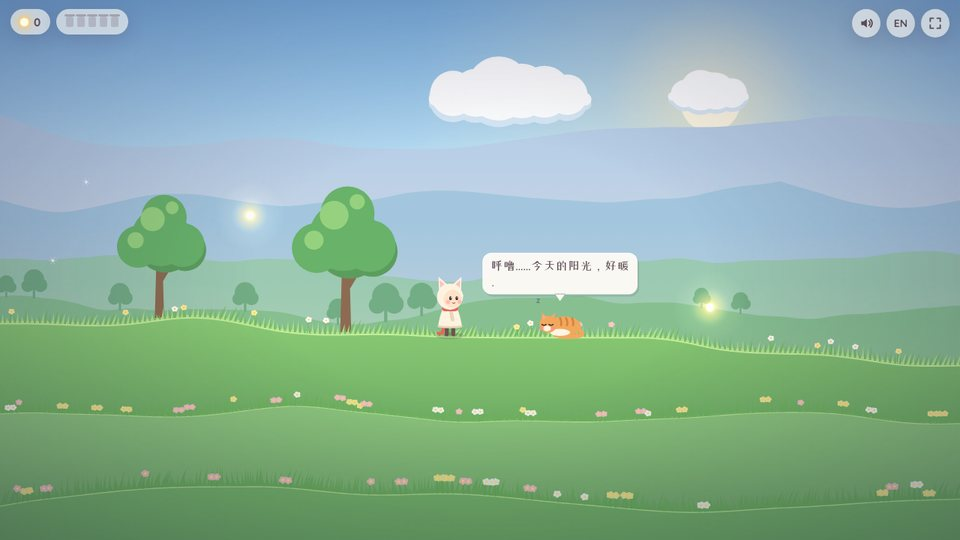
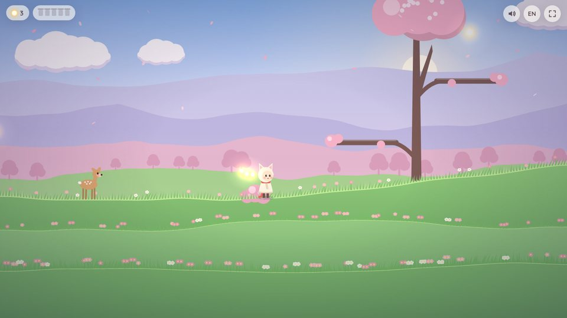
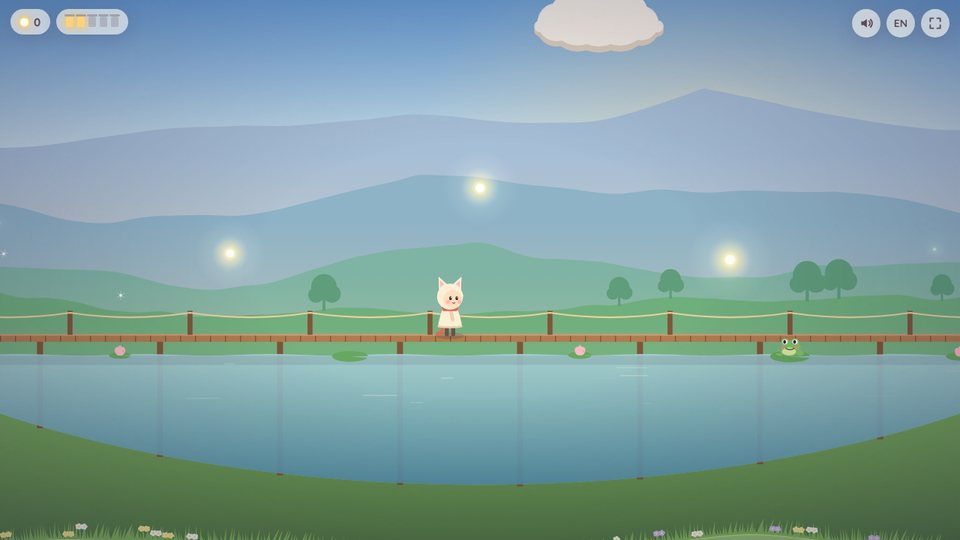
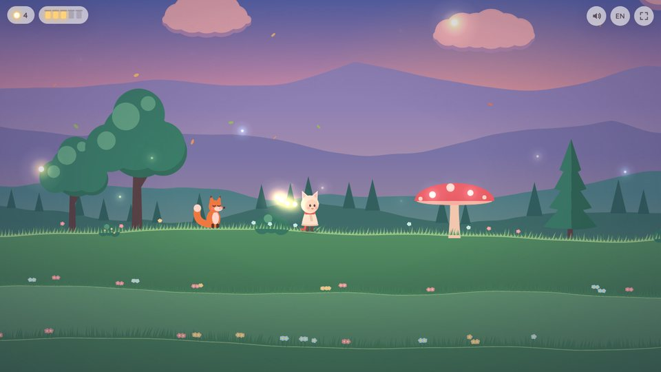
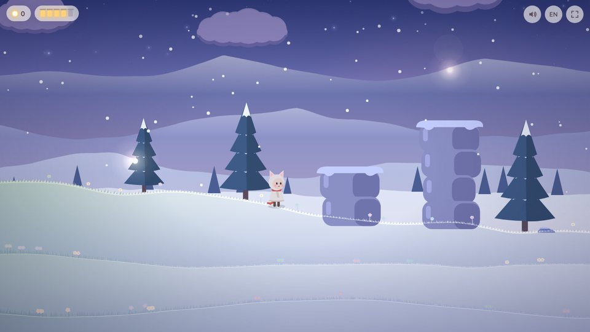
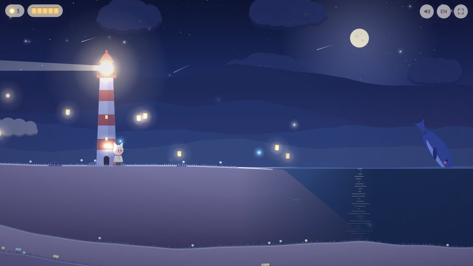

# 萤火小径 · Firefly Trail

一个治愈系的 2D 跑图小游戏：从清晨的花田出发，经过樱花坡、镜湖、黄昏森林和雪原，慢慢走到夜晚海边的灯塔。

*A cozy 2D exploration game: a slow little walk from a morning meadow to a lighthouse by the night sea.*

> 来自评论区 **@_月云** 的留言：「可以做那种治愈的2D跑图游戏嘛，主要很喜欢那种美术风格」
> —— 于是就做了这个 ♡


演示视频（可直接发布）：[`docs/demo/`](docs/demo/) 里有竖版 9:16 和横版 16:9 两个版本、封面图，以及写好的发布文案 `post.md`。
视频由 `tools/video/make.sh` 从游戏里逐帧录制生成。

## 怎么玩 · How to play

- 一路收集漂浮的 **微光**，它们会排成一串跟在你身后。
- 每盏石灯笼需要 **3 个微光**。点亮以后，灯笼周围会开出一圈花，你会收到一张小明信片。
- 五盏灯笼都亮了，就去海边 **点亮灯塔**。
- 路上会遇到猫、小鹿、青蛙、狐狸、雪兔和螃蟹，可以摸摸它们。
- 走累了就 **坐下来看风景**：镜头会慢慢拉远，主角会想一些小事情。
- 进度会自动保存在浏览器里（关掉再打开会出现「继续旅程」）。

| | 键盘 Keyboard | 手机 Touch |
|---|---|---|
| 走 / 跑 Walk / run | `←` `→` 或 `A` `D`（按住会慢慢跑起来，`Shift` 直接跑） | 左下角箭头 |
| 跳 / 滑翔 Jump / glide | `空格` / `↑`，在空中按住会撑开一片叶子慢慢飘 | 右下角大按钮 |
| 互动 Interact | `E` / `Enter` | ✋ 按钮 |
| 坐下 Sit | `↓` / `S` | 坐下按钮 |
| 声音 / 语言 | `M` / `L` | 右上角按钮 |

## 六个地方，也是一天 · Six places, one day

越往东走，天色越晚：

| 地方 | 时间 | 天气 |
|---|---|---|
| 花田 Flower Meadow | 清晨 | 蒲公英、蝴蝶 |
| 樱花坡 Blossom Hill | 上午 | 樱花瓣 |
| 镜湖 Mirror Lake | 午后 | 木桥、睡莲、波光 |
| 黄昏森林 Twilight Woods | 日落 | 落叶、萤火虫、会弹跳的大蘑菇 |
| 雪原 Snowfield | 入夜 | 下雪、第一颗星星 |
| 星海岸 Starlit Shore | 夜 | 月光、海浪、灯塔、流星 |

| | | |
|---|---|---|
|  |  |  |
|  |  |  |


## 怎么做的 · How it's made

- 纯 **HTML5 Canvas 2D + Web Audio**，没有任何图片、音频素材，也没有构建步骤。所有东西都是代码画出来的。
- 画面：多层视差远山 + 大气透视、渐变天空、从早晨到星空的时间变化、加法混合的光晕、一点点纸张颗粒感。
- 声音：程序实时生成的八音盒旋律、和弦铺底、风声和水声，每次玩都不太一样。
- 中文 / English 双语；手机横屏、竖屏都能玩；低端设备会自动切换到轻量画质。

```
index.html      页面骨架、HUD、明信片、触屏按钮
style.css       界面样式
js/util.js      数学 / 颜色小工具
js/i18n.js      所有文字（中文 / English）
js/world.js     六个地区的配色、地形、灯笼 / 小动物 / 微光的位置
js/draw.js      渲染：天空、远山、树、水、角色、小动物、粒子、光
js/audio.js     生成式音乐和音效
js/game.js      输入、物理、互动、存档、结局
```

## 本地运行 · Run locally

```bash
python3 -m http.server 8000
# 打开 http://localhost:8000
```

直接双击 `index.html` 也能玩（字体需要联网加载，没网会用系统字体）。

调试用的网址参数：`?play&x=12000`（直接从某个位置开始）、`&lit=5`（点亮前几盏灯）、`&motes=6`（带几个微光）、`&lang=en`、`&nosave`、`&lite`。

## 部署 · Deploy

仓库里带了 GitHub Pages 的 workflow（`.github/workflows/pages.yml`）。在仓库 **Settings → Pages → Source** 选 **GitHub Actions**，推送到 `main` 之后就会自动发布。

---

献给 @_月云，和所有喜欢慢慢走路的人。
